# Getting started

This guide takes you from a folder of RPG source in a git repository to Sim i that compiles it, shows what it finds, holds a copy of some data from your real IBM i, and lets you debug in VS Code.

You need Docker with the compose plugin, VS Code (or any editor that speaks the Debug Adapter Protocol), and, for part 3 and the second half of part 5, a real IBM i whose FTP server you can sign on to. The screenshots use these stand-in names for that system: host `ibmi.example.com`, user `DEVUSER`, library `ERPDATA`.

1. [Bring Sim i up with your source](#1-bring-sim-i-up-with-your-source)
2. [Check for warnings and errors](#2-check-for-warnings-and-errors)
3. [Copy data in from a real IBM i](#3-copy-data-in-from-a-real-ibm-i)
4. [Set up VS Code](#4-set-up-vs-code)
5. [Debug an application](#5-debug-an-application)

## 1. Bring Sim i up with your source

### Lay out the source

Sim i reads a folder at start-up. Each folder directly in it is a library, and a folder inside that is a source file. Each file in there is a member, named after the file:

```
source/
  DEMOLIB/                      library DEMOLIB
    QRPGLESRC/
      invoice.rpgle             member INVOICE of DEMOLIB/QRPGLESRC
      custlist.sqlrpgle
    QDDSSRC/
      custlistd.dspf
    QSQLSRC/
      tables.sql
```

Extensions it reads: `.rpgle`, `.sqlrpgle`, `.rpgleinc`, `.dspf`, `.prtf`, `.sql`, `.clle`, `.cmd`. Folders whose names start with a dot (`.git`, `.vscode`) are skipped. A file straight in a library folder goes in the source file its type usually has (`QRPGLESRC`, `QDDSSRC` or `QSQLSRC`), and a file straight in the source folder goes to `QGPL`. A name with `#035` in it, as ARCAD saves `#`, has `#` there: `C#035INACTIVE.rpgleinc` is member `C#INACTIVE`.

Your repository may keep this layout at its root or in a subfolder. Either way, the folder you give Sim i is the one that holds the library folders. In the rest of this guide it is `/home/you/work/erp-repo/source`.

### Point Sim i at it

Put a `.env` beside `compose.yaml` naming the folder, and the user to sign on with. Compose reads it by itself:

```bash
SIM_I_SOURCE=/home/you/work/erp-repo/source
SIM_I_USER=PRTUSER
SIM_I_PASSWORD=Secret12
```

`SIM_I_SOURCE` is the path on your machine; it can be any folder. The container runs as a non-root user, so the files must be readable by everyone (a normal checkout is). Sim i makes the test user `PRTUSER` only when `SIM_I_USER` is set. For code-server, set a developer as well (see the README's "One web address").

### Start it

```bash
docker compose up --build
```

The first run builds the image and starts PostgreSQL, where Sim i keeps everything: each library is a schema of its database. The database, the IFS and the TLS certificate are in named volumes, so they survive `docker compose down`. `docker compose down -v` throws them away.

At start-up Sim i does this, in order:

1. Opens the database and lists its libraries.
2. Puts the users from `.env` in the user table (`PRTUSER` / `Secret12`, as set above, is the one to sign on with).
3. Reads the source folder. A library folder that isn't a library yet makes one. Each member that is new or has changed since the last start is saved, checked and created: copy members first, then SQL scripts, then display and printer files, then RPG programs, then CL programs. A member that hasn't changed and is already made is skipped, so a restart is quick.
4. Starts the servers: 5250 on 2323, the host servers on IBM's ports, the web editor on 8080 and the debug server on 4711.

The tail of the log looks like this:

```
source: library DEMOLIB created
source: DEMOLIB/QSQLSRC(TABLES) SQL: 2 SQL statements run from DEMOLIB/QSQLSRC(TABLES).
source: DEMOLIB/QDDSSRC(CUSTLISTD) DSPF: File CUSTLISTD created in library DEMOLIB.
source: DEMOLIB/QRPGLESRC(BADCALC) RPGLE: DEMOLIB/QRPGLESRC(BADCALC) not compiled: 1 error in the source: see the member's diagnostics.
source:   line 6: error: TOTAL isn't defined
source: DEMOLIB/QRPGLESRC(COLORS) RPGLE: Program COLORS created in library DEMOLIB. 1 line can't be run: see the member's diagnostics.
source:   line 6: not supported: commitment control isn't supported (COMMIT)
source: DEMOLIB/QRPGLESRC(HELLO) RPGLE: Program HELLO created in library DEMOLIB.
source: DEMOLIB/QRPGLESRC(INVOICE) RPGLE: Program INVOICE created in library DEMOLIB.
Sim i listening on 0.0.0.0 port 2323 and TLS port 992; Ctrl+C to stop
Sim i web source editor listening on port 8080: http://localhost:8080/
Sim i debug server (Debug Adapter Protocol, for VS Code) listening on port 4711
```

Members with errors do not stop Sim i from starting. If the source folder doesn't exist, it does stop, with `the source folder ... doesn't exist`.

Open <http://localhost:8080/> and sign on as `PRTUSER` / `Secret12` to see that it is up.

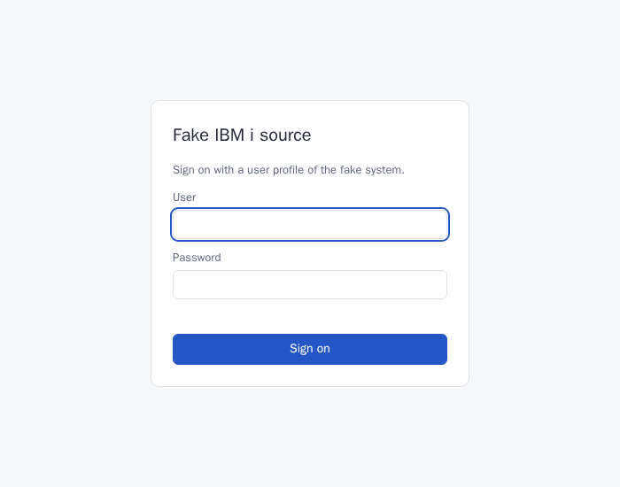

## 2. Check for warnings and errors

### What the log reports

Each member gets one line, `source: LIBRARY/FILE(MEMBER) TYPE: result`, and below it one line for each finding, with the line number in the source. There are three kinds:

| In the log | In the editors | What it means |
| --- | --- | --- |
| `error` | red | Source an IBM i's compiler would reject. Nothing is made from the member (`not compiled`), so it can't be called. |
| `not supported` | warning | Valid RPG that Sim i can't run. The program is still made; reaching that line ends the call with a message naming it. |
| `warning` | warning | Something Sim i checked and found suspect, or translated or ignored. |

An error means a real IBM i would reject the source too. A word Sim i doesn't support is never an error; it is a warning. The lists are in [rpg-support.md](rpg-support.md).

### Check without starting anything

To see the same report without touching the database or starting servers, run Sim i with `--check` and the source folder you already named in the override file:

```bash
docker compose run --rm --no-deps sim-i --check
```

It checks every member against a scratch database and prints the same lines, ending with a count:

```
source: DEMOLIB/QRPGLESRC(BADCALC) RPGLE: checked.
source:   line 6: error: TOTAL isn't defined
source: DEMOLIB/QRPGLESRC(COLORS) RPGLE: checked.
source:   line 6: not supported: commitment control isn't supported (COMMIT)
source: 2 lines not supported or in error
```

The exit code is 3 when that count isn't zero. The count includes `not supported` lines, so a source folder with only warnings also exits 3. Use the log text, not the exit code alone, if you want to tell them apart.

### In the web editor

Open <http://localhost:8080/> and sign on. The list on the left has a dot for each member: green for ok, amber for a warning, red for an error. Click a member to see its findings under the source, with the lines marked in the gutter.

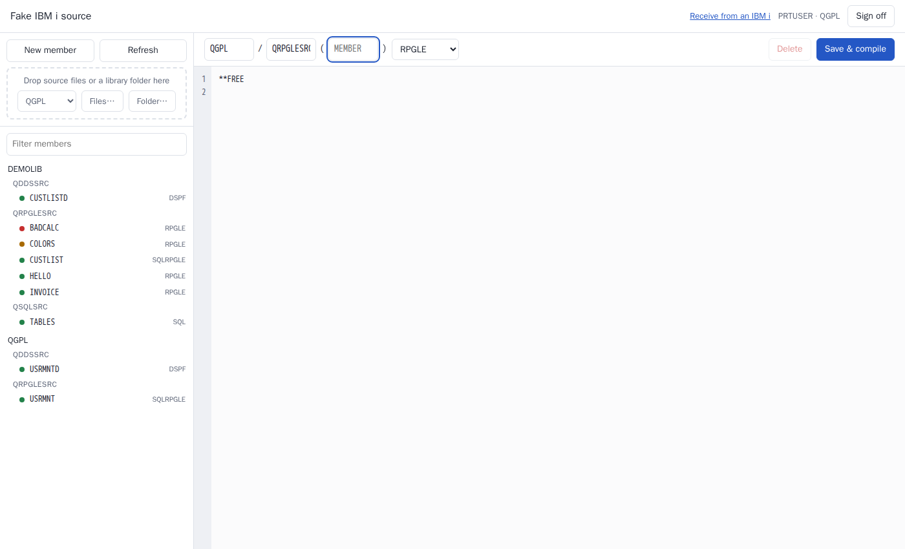

An error, as the IBM i would report it:

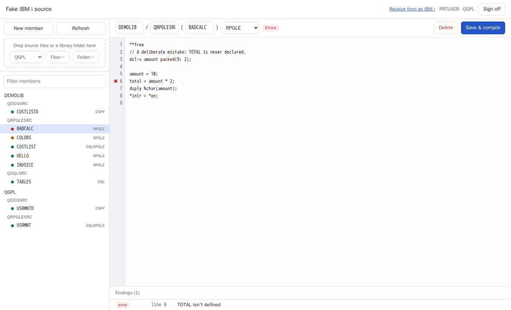

A warning:

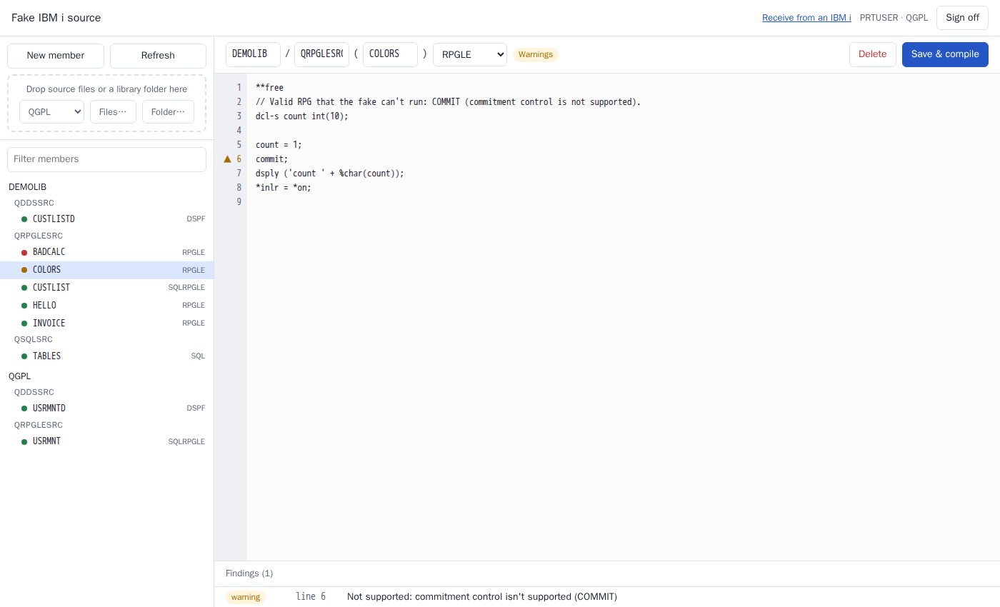

You can edit here and press **Save & compile** (Ctrl+S). That changes the member in Sim i's database only, not your repository.

### In VS Code

Once the extension is set up (part 4), each save is sent to Sim i and compiled. What it finds appears in the **Problems** panel (Ctrl+Shift+M), errors in red and warnings in amber, and the status bar says how the member went.

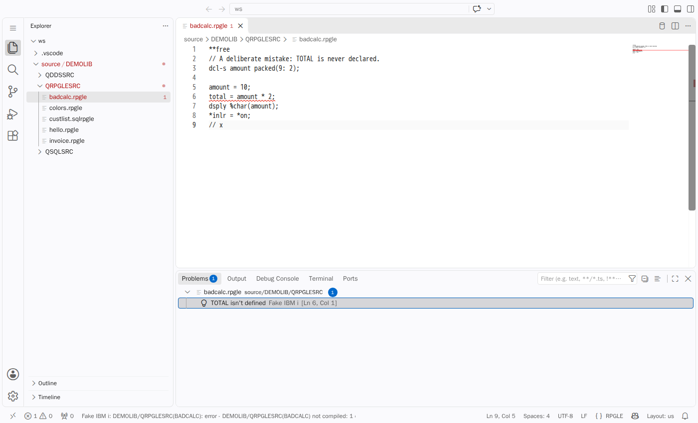

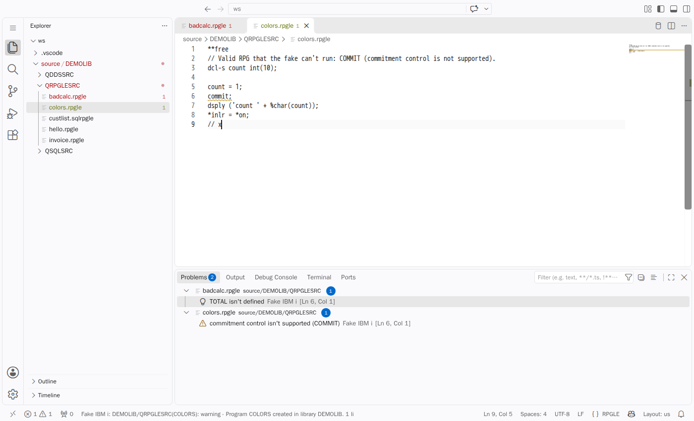

## 3. Copy data in from a real IBM i

Programs that read files need the files. Sim i can fetch them from a real IBM i over its FTP server. Sim i reads the descriptions and the records and builds the same files in its own database. It works in the FTP session's `QTEMP` on the real system and changes nothing else there. The user you sign on with needs to read the objects, and to run `DSPFD`, `DSPFFD`, `DSPOBJD` and `RUNSQL`.

The host you give has to be reachable from where Sim i runs. Under Docker that is from inside the container.

### The web page

1. Open <http://localhost:8080/receive> (the **Receive from an IBM i** link in the web editor's header) and sign on as `PRTUSER`.
2. Fill in the remote system, its FTP port (21 unless yours differs), the user, the password and the library. Tick **Insist on TLS** to refuse a connection that isn't encrypted. Then press **Connect and list**.

   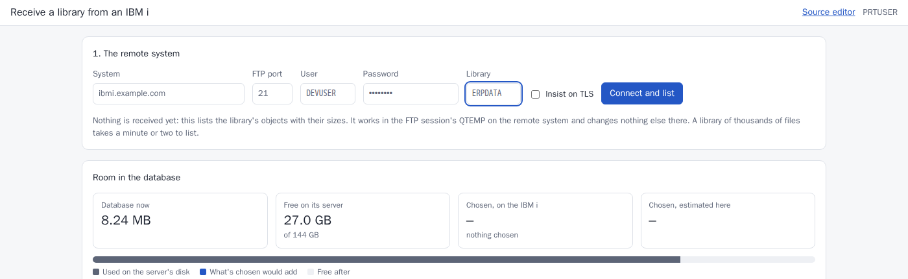

3. The page surveys the library. It does nothing else on the remote system. A library of thousands of objects takes a minute or two. The result is every object of the library with its kind, its record count, its size there and an estimate of the room it will take here. At the top are the database's size and the room free on its server. The page also says whether the connection is encrypted; in the screenshot the system's FTP server offers no TLS.

   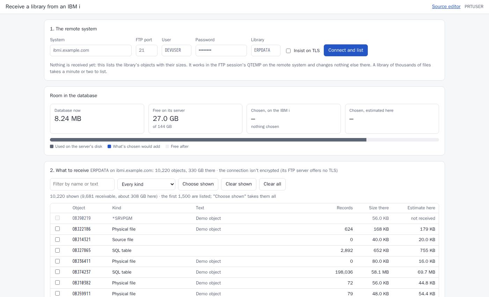

   In this screenshot, and in the next ones, the names of the real system's objects are replaced. Only the ones named STATES, SHIPTO, DIVISIONS and SHIPBYNAME were chosen.

4. Choose what to receive. The filter matches names and text, **Choose shown** ticks what the filter shows, and a ticked row adds to the totals. Programs and other compiled objects are listed but can't be ticked.

   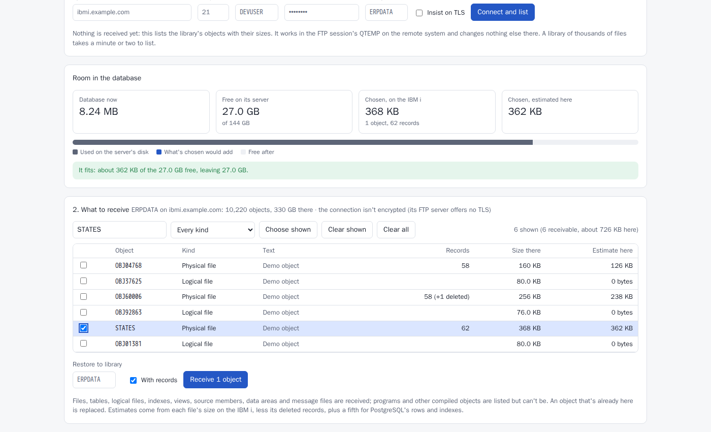

5. Check the totals. The page says whether what you chose fits in the free room before anything is received. Set **Restore to library** (the library here that receives them) and whether to receive **With records**.

   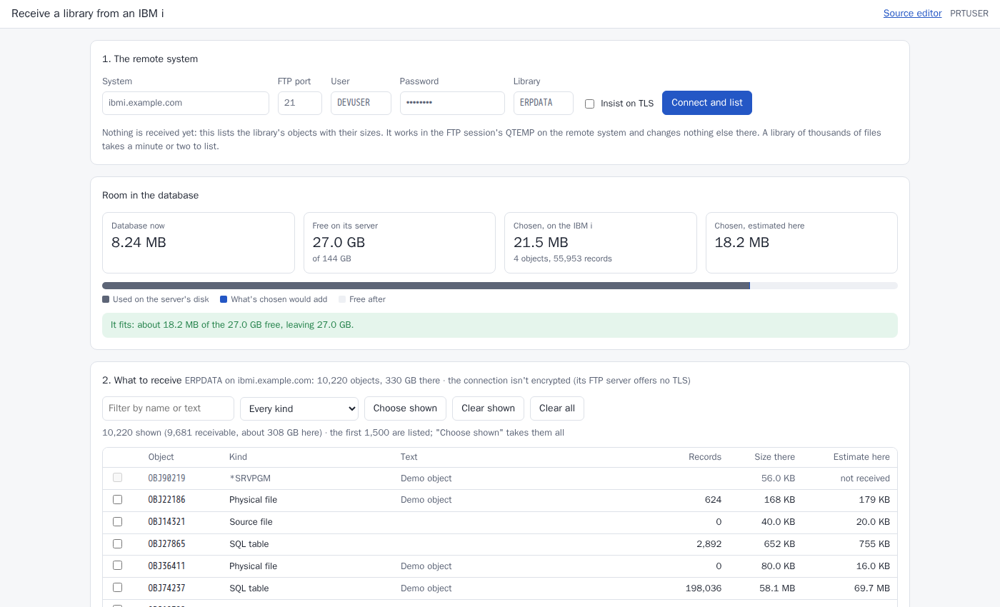

6. Press **Receive**. It runs in the background, one object at a time, showing objects and records done and how much the database has grown against the estimate. **End it** stops it, which leaves the file it was on empty.

   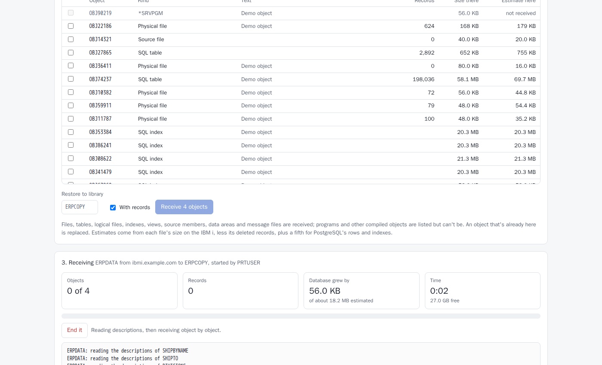

7. When it ends the page says what was restored and names the spooled file `QPSRODSP`, which lists each object and what happened to it.

   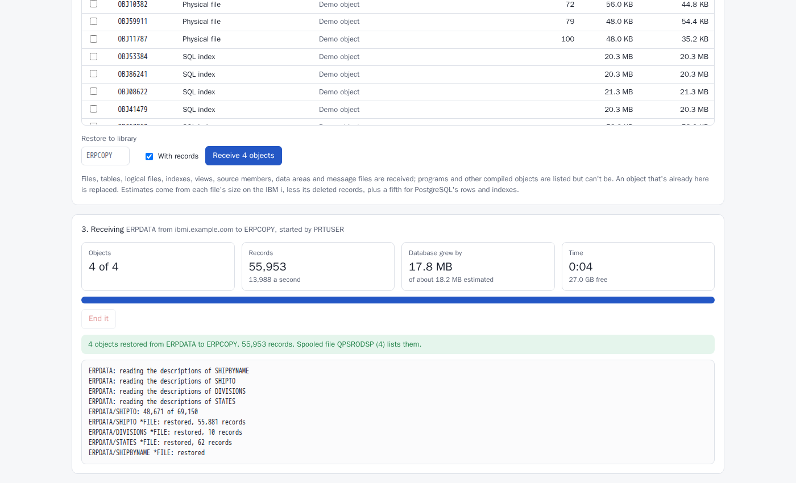

### The commands

On the 5250 command line (or through the remote command server), `SAVRSTLIB` and `SAVRSTOBJ` do the same job. On a real IBM i these commands send a library *to* a remote system; on Sim i they bring one *from* it. The parameters that exist only on Sim i:

| Parameter | Meaning |
| --- | --- |
| `RMTLOCNAME(host)` | The real system. |
| `RMTUSER(name)` and `RMTPWD('password')` | The user and password for its FTP server. |
| `DATA(*NO)` | Receive files without their records. |
| `WHERE('condition')` | Only the records that meet an SQL condition, written as the remote system takes it. The file is `A`, so `WHERE('RRN(A) <= 5000')` is each file's first 5,000 records. |
| `RSTLIB(name)` | Put the objects in another library here. Needs `LIB` to name one library. |
| `PORT(n)` and `SECCNN(*DFT / *SSL / *NONE)` | The FTP port, and whether to insist on TLS or not to try it. |

For example:

```
SAVRSTLIB LIB(ERPDATA) RMTLOCNAME(ibmi.example.com) RMTUSER(DEVUSER) RMTPWD('secret') DATA(*NO)

SAVRSTOBJ OBJ(CUSTOMER ORD*) LIB(ERPDATA) RMTLOCNAME(ibmi.example.com) RMTUSER(DEVUSER) RMTPWD('secret') WHERE('RRN(A) <= 5000') RSTLIB(ERPCOPY)
```

`OBJ` takes names, generic names (`ORD*`) or `*ALL`; `OBJTYPE(*FILE *DTAARA *MSGF)` and `OMITOBJ(ABC* XYZ)` narrow the choice. To keep the password off the command line, set `SIM_I_REMOTE_USER` and `SIM_I_REMOTE_PASSWORD` in Sim i's environment; `RMTUSER` and `RMTPWD` on a command win over them. Under compose, put them in `compose.override.yaml` under `environment:`, with the password taken from your shell (`SIM_I_REMOTE_PASSWORD: ${IBMI_PW}`) so it isn't written into a file you commit.

The message says how many objects and records came, and `QPSRODSP` lists each one. An object that fails doesn't stop the rest; the command then ends with CPF3773.

### What comes and what doesn't

- Physical files and SQL tables come with their fields, record format, key and records. Logical files, SQL indexes and views are made again over the files received (one whose physical file isn't here isn't made, and is listed). Source physical files come with their members. Data areas and message files come too.
- Programs, service programs, display files and printer files, and every other compiled object, do not come. Compile them here from their source (that is what part 1 is for).
- LOB, DATALINK and ROWID columns are left out. A file with several members brings its first.
- Each run reloads a file in full: an object that is already here is replaced, not updated. There is no incremental refresh. For a big file, copy a slice with a filter.
- The FTP password crosses the network in the clear if the real system's FTP server has no TLS. Sim i uses TLS when the server offers it (`SECCNN(*SSL)` insists on it), but it doesn't check the server's certificate. Use a development partition, and a user that exists only for this.

## 4. Set up VS Code

The extension is the folder `vscode/sim-i` of this repository. It has no dependencies to install.

### Install it

The extension isn't published to a marketplace. Its README gives two ways:

- Copy the folder to `~/.vscode/extensions/sim-i.sim-i-0.1.0` and restart VS Code.
- Build a package with `npx @vscode/vsce package` in that folder and install the `.vsix` (Extensions view, `...` menu, **Install from VSIX**).

The first one was tried with the folder copied to a code-server extensions directory under that name (code-server is VS Code in a browser and loads the same extension format). `vsce` and a desktop VS Code were not tried.

To check that it loaded, press F1 and type `Sim i`. Four commands appear:

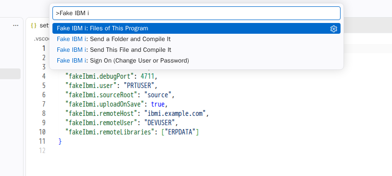

### Open the source and set the settings

1. Open the folder that holds your source as `LIBRARY/FILE/member.ext`. If that is not the workspace folder, name it in `simI.sourceRoot`: an absolute path, or one relative to the workspace folder.
2. Put the settings in `.vscode/settings.json` (or in the Settings UI, under **Sim i**):

```json
{
  "simI.host": "localhost",
  "simI.webPort": 8080,
  "simI.debugPort": 4711,
  "simI.user": "PRTUSER",
  "simI.sourceRoot": "source",
  "simI.uploadOnSave": true,
  "simI.remoteHost": "ibmi.example.com",
  "simI.remoteUser": "DEVUSER",
  "simI.remoteLibraries": ["ERPDATA"]
}
```

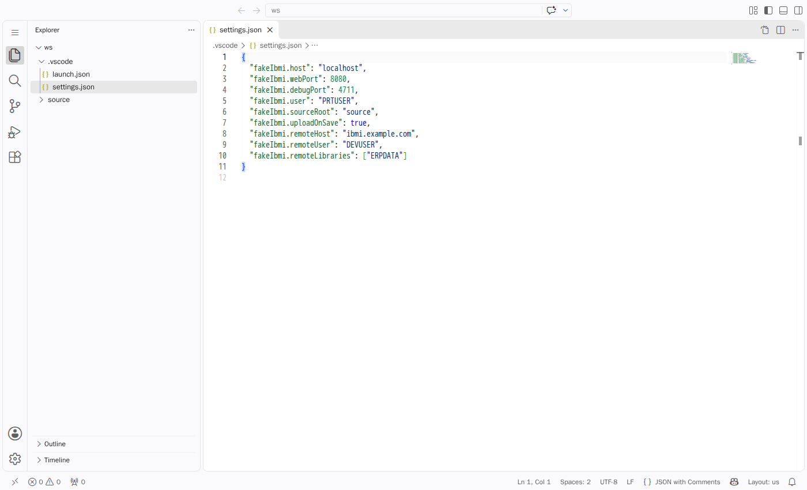

| Setting | Default | Meaning |
| --- | --- | --- |
| `simI.host` | `localhost` | Sim i's host name or address. |
| `simI.webPort` | `8080` | Its web port; saved source is sent there. |
| `simI.debugPort` | `4711` | Its debug port. |
| `simI.user` | empty | The user profile to sign on to Sim i with. |
| `simI.sourceRoot` | empty | The folder laid out `LIBRARY/FILE/member.ext`, when it isn't the workspace folder. |
| `simI.uploadOnSave` | `true` | Send each source file to Sim i when it is saved, so that it is checked and compiled. |
| `simI.remoteHost` | empty | The real IBM i that a program's files are copied from. |
| `simI.remoteUser` | empty | The user to sign on to the real IBM i with. |
| `simI.remoteLibraries` | `[]` | The libraries on the real IBM i to look in for a program's files, in order. |

The remote settings are sent to Sim i, and Sim i makes the connection. So `remoteHost` must resolve from where Sim i runs, which under Docker is inside the container.

### Upload on save

Save a source file. The first time, VS Code asks for the password of the user you set, and keeps it in its secret storage:

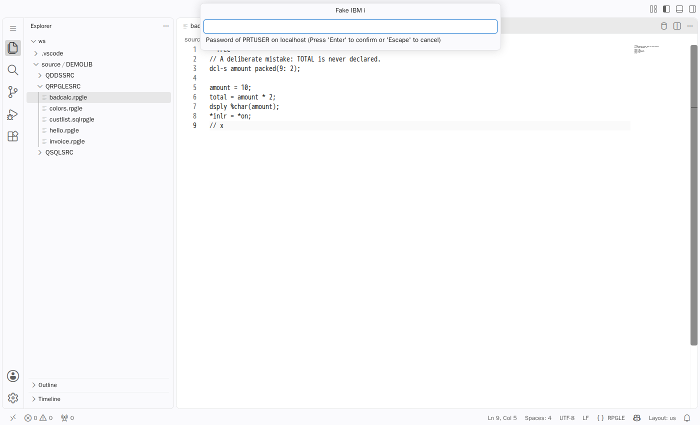

The file is sent to Sim i, which saves the member, checks it and compiles it. The status bar and the Problems panel show how it went (see part 2). Two commands send more than one file: **Sim i: Send This File and Compile It**, and **Sim i: Send a Folder and Compile It**, which sends a whole library or source file folder in the order its members depend on one another. **Sim i: Sign On (Change User or Password)** changes the user or the password.

Set `simI.uploadOnSave` to `false` to stop saving from sending; the two commands still work.

## 5. Debug an application

Sim i's debug port speaks the Debug Adapter Protocol, and VS Code connects to it directly. Debugging is of RPG only.

### Save first

Sim i runs the source it was last compiled from. Save the file (which compiles it) before you start. A breakpoint in a file that has been changed and not saved is off by the lines you added.

### Launch configurations

Add `.vscode/launch.json`:

```json
{
  "version": "0.2.0",
  "configurations": [
    {
      "type": "sim-i",
      "request": "launch",
      "name": "Call INVOICE",
      "program": "DEMOLIB/INVOICE"
    },
    {
      "type": "sim-i",
      "request": "attach",
      "name": "Sim i: attach to my 5250 session"
    }
  ]
}
```

- **launch** calls a program in a job of its own. `program` is `LIBRARY/NAME` (left out, it is the program of the source file that is open), and `parms` is a list of parameters, for example `"parms": ["A", 100]`. `"stopOnEntry": true` stops at the first statement. `DSPLY` output goes to the debug console.
- **attach** is for a program with a display file. Start the configuration, then call the program in a 5250 session signed on as the same user; the session stops at your breakpoints with its screen waiting. `"jobUser": "OTHER"` or `"*ALL"` debugs other users' jobs.

The README of the extension says F5 on an RPG source file with no `launch.json` calls its program. That did nothing when tried in code-server, so these steps use a launch configuration.

### Set breakpoints and run

1. Open `invoice.rpgle`, click in the gutter to set a breakpoint, or press F9 on a line.
2. Give it a condition (an RPG expression) or a log message: F1, then **Debug: Add Conditional Breakpoint** or **Debug: Add Logpoint** (the extension's README says a hit count is set from the breakpoint's context menu; that one was not tried). Below, line 14 stops only when `line = 2`, and line 15 logs `line {line} qty {qty}` instead of stopping.

   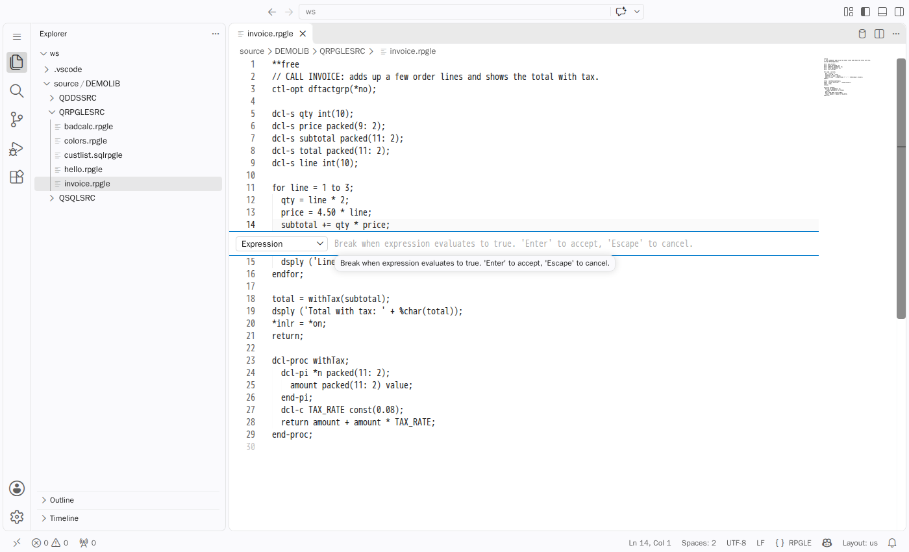

3. Choose the configuration in the Run and Debug view and press F5. The first time, VS Code asks for the password of your Sim i user.

The program stops at the breakpoint. The call stack shows the program and each procedure with its line, **Variables** shows the program's variables (and, in a procedure, its parameters and locals), and the log message and `DSPLY` output are in the debug console:

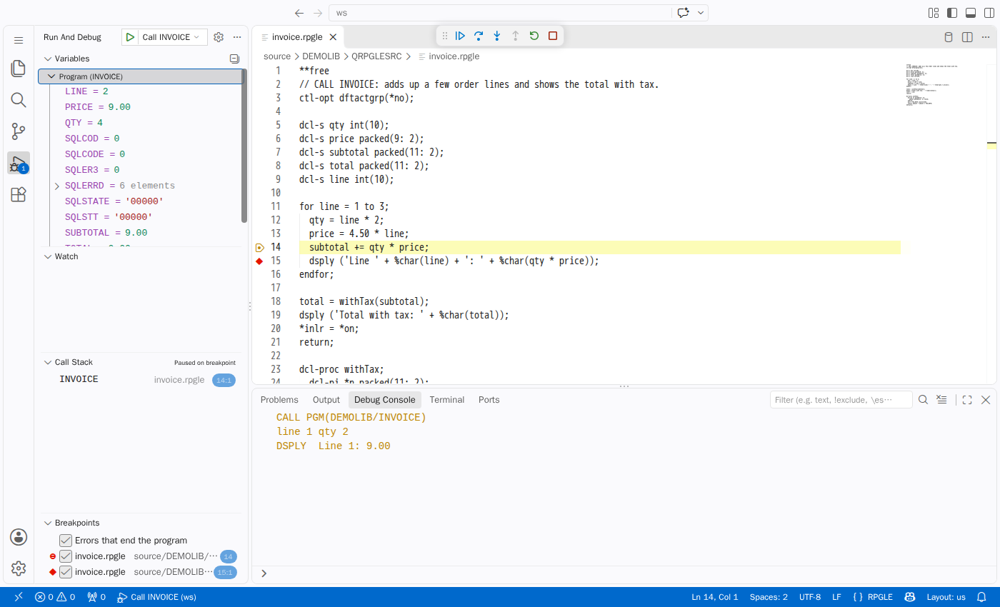

### Step

F10 steps over, F11 steps into a procedure or a called program, Shift+F11 steps out, F5 continues. After a breakpoint on `total = withTax(subtotal);` and F11, the stack has `INVOICE.WITHTAX` over `INVOICE`:

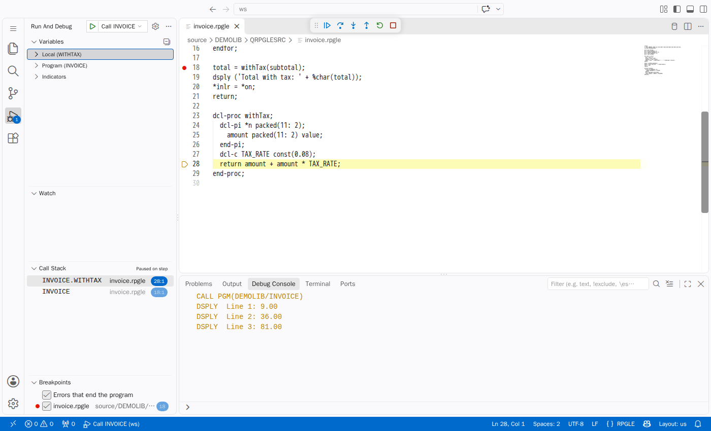

### Variables, watch and the debug console

Variables open into subfields and array elements. The watch list, hovering over a name and the debug console take RPG expressions. In the console, `eval name = value` changes a variable:

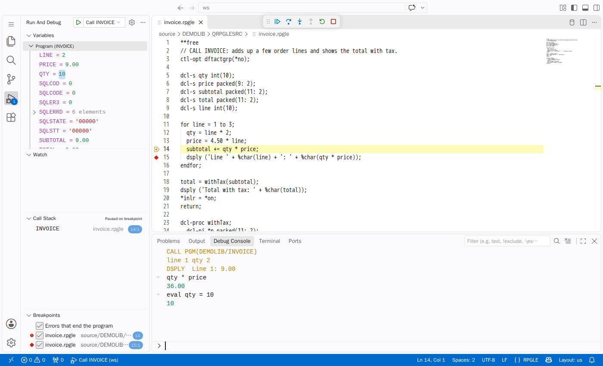

Here `qty * price` was evaluated, `eval qty = 10` changed `QTY`, and `qty` showed 10.

### Data breakpoints

Right-click a variable in **Variables** and choose **Break on Value Change**. The program stops after the statement that changes it. The call stack header says so (`SUBTOTAL changed from 99.00 to 180.00`), and the breakpoint is listed with the others:

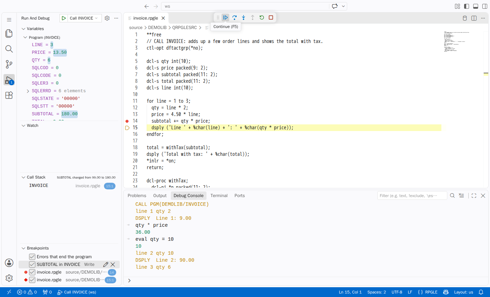

### Run to the end

Continue with F5. `DSPLY` lines are in the debug console, and the session ends:

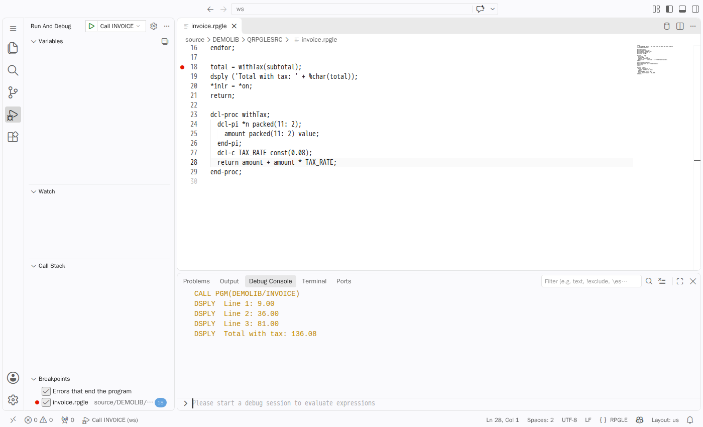

### Files of This Program

A program that reads files from your real IBM i can't run until those files are here. The panel finds them, copies them, and compiles the program again. The program below (invented for this guide) reads two files, runs SQL on a third and describes a data structure from a fourth:

```rpgle
**free
dcl-f states keyed;
dcl-f shipbyname keyed;
dcl-ds divisions extname('DIVISIONS') qualified end-ds;
dcl-s n int(10);
exec sql select count(*) into :n from saleslog where margin is null;
read states;
dow not %eof(states);
  dsply (statecd + ' ' + %trim(statenm));
  read states;
enddo;
dsply ('rows with no margin: ' + %char(n));
*inlr = *on;
```

1. Make sure `simI.remoteHost`, `remoteUser` and `remoteLibraries` are set, and save the file.
2. With the source open, click the database icon above the editor, or press F1 and run **Sim i: Files of This Program**. The panel lists the files the program uses: its file declarations, the tables its embedded SQL names and the files its data structures are described by (`EXTNAME`), with what each is on Sim i. Here none is there yet, and Problems shows errors for the files the program can't find.

   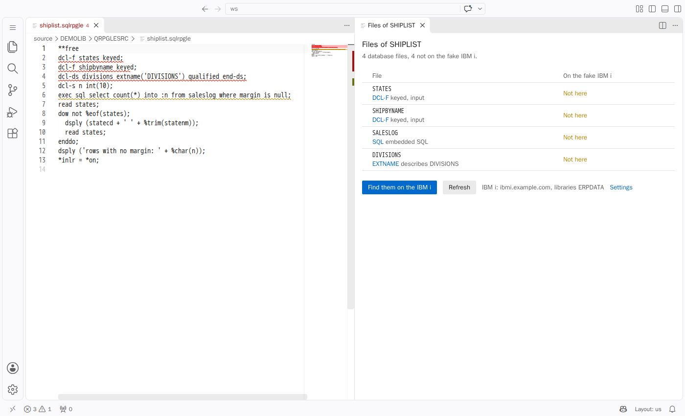

3. Press **Find them on the IBM i**. It asks for the remote password once. The panel then shows each file as it is on the real system: its records and size, and an estimate of the room it will take here. It also adds the physical files that the program's logical files are over (here `SHIPTO`, needed by `SHIPBYNAME`). The files that are not here yet are ticked.
4. Under **Only records where**, give a big file a filter. An SQL condition works (`ORDDAT >= 20260101`); `RRN(A) <= 5000` is the first 5,000 records. `SALESLOG` had 803,954 records on the real system, so it gets that one. Untick **with records** to copy only the file descriptions.

   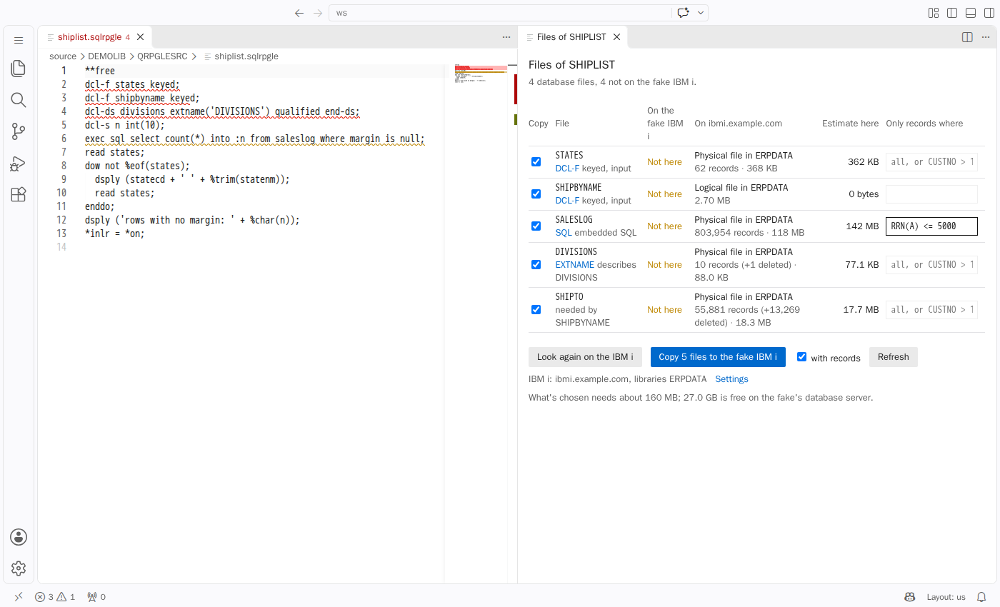

5. Press **Copy ... to Sim i**. The panel logs each file as it arrives and says how many objects and records were restored. The program is compiled again, and the status bar says `compiled`. The files now show their record counts here; `SALESLOG` has only 5,000 records.

   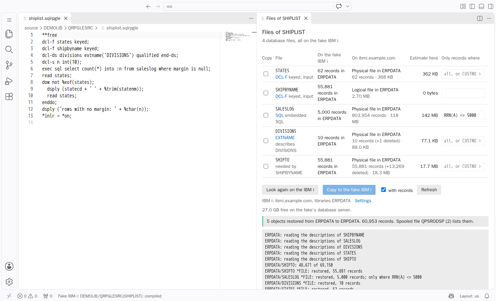

### Limits

- Only RPG is debugged. A CL program runs through without stopping, and the RPG it calls is stopped in.
- Statements brought in by `/COPY` have their own line numbers, so a breakpoint on a line can stop in a copied statement with the same number.
- The debug port isn't encrypted. A debugger signs on with a user profile.
- Save before you debug (see above).
- Each copy of a file from the real IBM i replaces it in full. See the end of part 3 for the other limits, including the FTP password.

## What was and wasn't run for this guide

The steps above were run with Sim i in Docker (`docker compose up --build` with a `compose.override.yaml` as in part 1) against a scratch repository of the layout in part 1: start-up and its log, `--check`, the web editor, the `/receive` page and the Files panel (both against a real development IBM i), and the VS Code part in code-server. `SAVRSTLIB` and `SAVRSTOBJ` were not run from a command line, and neither were `vsce package`, an attach configuration, a hit-count breakpoint, a 5250 session or a desktop VS Code. For those, the guide follows the code and the READMEs.
